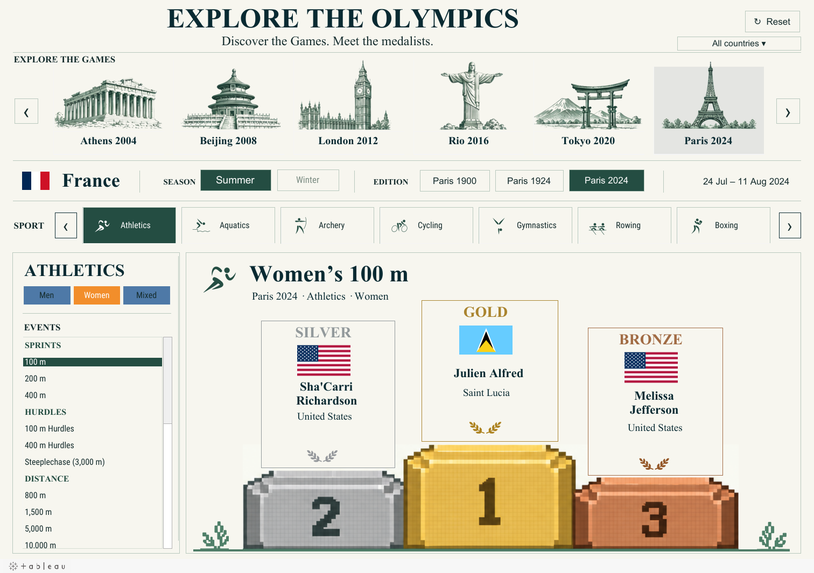

# Explore the Olympics

**An interactive Tableau project exploring 55 Olympic editions, 7,098 events and the people behind the medals.**

Who stood on the podium—and how do you find their story across more than a century of Olympic Games?

I built this dashboard around a simple journey: choose a host city, pick an edition and sport, then explore the medalists in an event. Illustrated landmarks lead into the Games, while flags, names and team details bring each podium to life.

**[Open the live Tableau dashboard](https://public.tableau.com/app/profile/shashank.pabitwar/viz/ExploretheOlympics/OlympicExplorer)** · **[Download the editable Tableau workbook](https://github.com/Shashankpabitwar123/explore-the-olympics/raw/refs/heads/main/tableau/Explore_the_Olympics.twbx)**

*Preview exported from the published dashboard. Opening view: Paris 2024 → Athletics → Women → 100 m.*

## How the project came together

### 1. Start with the Games and their medalists

The saved dataset covers **1896–2026**, with 30 Summer editions and 25 Winter editions. It connects editions, events, medal awards, delegations and recorded team members using IDs.

There are **21,821 medal awards** and **31,194 roster-member records**. A team winning gold counts as one award; its members are stored separately. That distinction keeps team sizes from inflating medal counts. The [source CSVs](data/source) retain the original values and record-level source links.

### 2. Make the data work for individual and team events

An Olympic podium does not always mean three individual athletes. Events can have teams, tied medals or missing recorded details.

I organized the results so the dashboard can show those differences. Historical delegations remain separate, team members stay connected to their award, and missing information stays marked as missing. Historical women's hurdle labels distinguish the 80 m and 100 m events while preserving the original source labels in the CSVs.

### 3. Turn the dataset into a visual journey

The dashboard moves from the Games to an individual event:

| Choose | What you can explore |
|---|---|
| A landmark or host country | Find the Games through an illustrated gallery |
| A city, edition and available season | Move between that city's Olympic editions |
| A sport | Browse the sports recorded for the selected Games |
| Men, Women, Mixed or Open | See the categories available for that sport and edition |
| An event | Read its gold, silver and bronze results, including recorded team details |

Gallery and sport arrows help navigate larger lists. **Reset** returns to the opening view. Tableau worksheets and parameter actions drive the selections; the landmark illustrations and podium artwork provide the visual setting.

### 4. Check the data inside the published workbook

The repository includes the workbook downloaded from Tableau Public, plus a [Python checking script](scripts/check_and_export.py). Its **23 checks** reconcile every award and event with the source tables, verify their relationships and confirm that all recorded roster names survive in the result labels.

The script also produces a small [edition summary](data/summary/editions.csv) that can be opened in Excel. [See the validation results](validation/check-results.json).

## Try this first

Open **Paris 2024 → Athletics → Women → 100 m**. The podium shows:

| Medal | Athlete | Delegation |
|---|---|---|
| Gold | Julien Alfred | Saint Lucia |
| Silver | Sha'Carri Richardson | United States |
| Bronze | Melissa Jefferson | United States |

Then select another event or use the gallery to explore an earlier edition. Beijing offers both Summer and Winter editions; Paris offers its 1900, 1924 and 2024 Summer Games.

## What I used

| Tool | Its role |
|---|---|
| Python and CSV | Organize records, reconcile relationships and export summaries |
| Tableau and Hyper | Package the data and build the event browser, selectors and podium |
| Tableau parameter actions | Keep the selected Games, sport, category and event connected |
| Illustrated landmarks, flags and sport icons | Make navigation recognizable and results easier to read |

## Explore the work

- [Open and edit the workbook](tableau/README.md)
- [Understand the data and counting rules](docs/data_dictionary.md)
- [Sources, artwork credits and coverage](docs/sources.md)
- [Run the checks and reproduce the summaries](docs/reproduce.md)
- [How the Tableau interactions work](docs/dashboard_notes.md)

This is a historical data snapshot dated **28 September 2026**. It explores recorded medal results; it is not a live results feed or a complete list of every Olympic participant. [Coverage and limitations](docs/sources.md#coverage-and-limitations) explain the boundaries.

**Built by Shashank Pabitwar.** · [Portfolio](https://shashankpabitwar123.github.io/Portfolio/)
